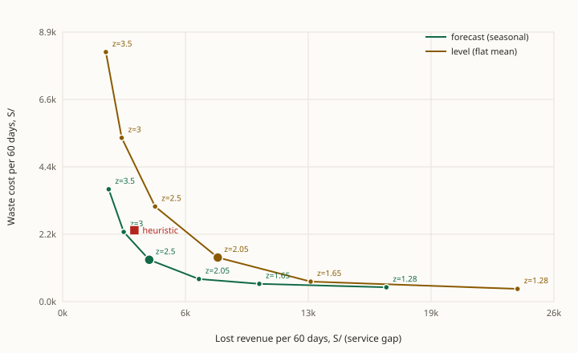

# Replenishment policy experiment

> Generated by `src/policy_experiment.py`. Do not edit by hand: every number below is recomputed on each run.

## Question

The business case assumes that better replenishment cuts waste. Does a forecast-driven ordering policy actually do that in this simulated network, and how much of any gain is due to *forecasting* as opposed to merely sizing orders sensibly?

## Design

| Item | Value |
|---|---|
| Network | 4 stores, 15 SKUs, 6 suppliers, 60 days ending 2026-10-11 |
| Training seeds | 20 (`1000`..`1019`), used ONLY to choose the service level |
| Test seeds | 100 (`2000`..`2099`), disjoint from training |
| Service-level grid | z in 1.28, 1.65, 2.05, 2.5, 3, 3.5 |
| Chosen on training | level z=2.05, forecast z=2.5 |
| Metric | net profit = gross margin - waste cost (lost sales never become margin, so stockouts are priced in) |
| Inference | paired by seed, percentile bootstrap, 10,000 resamples, 95% interval |

The three policies:

- **heuristic** - the legacy rule: a static order-up-to level from the catalog base demand, blind to the weekday pattern, with one extra day of cover.
- **level** - base-stock with the correct cover and a statistical safety stock, but demand is the flat mean of the last 14 days. No seasonality.
- **forecast** - the same base-stock, with demand from a same-weekday forecast.

`forecast` vs `level` isolates the value of forecasting. `level` vs `heuristic` isolates the value of sizing orders properly.

## Results on 100 held-out seeds

Mean per 60-day run, S/ (units for fill rate).

| Policy | Net profit | Gross margin | Waste cost | of which expiry | Lost revenue | Fill rate |
|---|---:|---:|---:|---:|---:|---:|
| heuristic | 178,105 | 180,448 | 2,343 | 1,778 | 3,729 | 99.2% |
| level (z=2.05) | 177,294 | 178,802 | 1,508 | 1,001 | 7,774 | 98.4% |
| forecast (z=2.5) | 178,756 | 180,137 | 1,381 | 836 | 4,874 | 99.0% |

### Paired differences

Mean difference, with 95% bootstrap interval. For net profit and fill rate a positive number is better; for waste and lost revenue a negative number is better.

| Comparison | Net profit | Waste cost | Lost revenue | Reading (net profit) |
|---|---:|---:|---:|---|
| forecast vs heuristic | +651 [+358, +952] | -962 [-1,028, -896] | +1,144 [+973, +1,314] | better |
| level vs heuristic | -811 [-1,110, -504] | -835 [-893, -774] | +4,044 [+3,831, +4,250] | worse |
| **forecast vs level** | +1,462 [+1,209, +1,714] | -127 [-195, -58] | -2,900 [-3,099, -2,701] | better |

### Reading the numbers

- Against the legacy heuristic, the forecast policy changes waste by **-41.1%** and expiry waste by **-53.0%**, and lost revenue by **+30.7%**.
- Net profit per run: forecast vs heuristic is **+651** (+0.4%), better.
- **The decomposition that matters.** The net difference (+651) splits into the value of forecasting itself, forecast vs level (**+1,462**, better), plus what a leaner order-up-to level does on its own without seasonality, level vs heuristic (**-811**, worse). The second term is significantly negative: a flat average is not merely unhelpful, tighter orders without a seasonal signal cost more in stockouts than they save in waste.
- Run-to-run noise: the standard deviation of net profit across seeds is about S/ 1,019 (heuristic), S/ 1,108 (level) and S/ 1,024 (forecast). A single-seed comparison would be unreliable, which is why this uses 100 seeds.

## Waste vs service frontier (training seeds)



Each learned policy trades waste against stockouts through its service level `z`; the larger dots mark the value chosen on training seeds. The heuristic has no such knob and sits at one point. A policy whose curve lies below and left of another dominates it: less waste *and* fewer stockouts at a matched service level.

| Policy | z | Net profit | Waste cost | Lost revenue |
|---|---:|---:|---:|---:|
| heuristic | - | 178,469 | 2,349 | 3,779 |
| level | 1.28 | 170,683 | 421 | 23,943 |
| level | 1.65 | 175,672 | 659 | 13,056 |
| level | 2.05 **(chosen)** | 177,159 | 1,451 | 8,168 |
| level | 2.5 | 176,704 | 3,130 | 4,865 |
| level | 3 | 175,059 | 5,389 | 3,111 |
| level | 3.5 | 173,135 | 8,209 | 2,279 |
| forecast | 1.28 | 173,909 | 472 | 17,041 |
| forecast | 1.65 | 176,554 | 586 | 10,352 |
| forecast | 2.05 | 178,028 | 745 | 7,173 |
| forecast | 2.5 **(chosen)** | 178,543 | 1,378 | 4,557 |
| forecast | 3 | 178,234 | 2,293 | 3,217 |
| forecast | 3.5 | 177,130 | 3,698 | 2,425 |

## Specification notes (what went wrong first)

These are recorded because the first version of the experiment was wrong in two instructive ways, and hiding that would overstate how clean the result is.

1. **Cover.** The first forecast policy copied the heuristic's cover of `interval + 1` days. For two-day-shelf-life hot food delivered daily, that holds two days of stock against a two-day life. Corrected to the textbook periodic-review base-stock: stock must last until the *next* delivery, i.e. `interval` days.
2. **Censored demand.** Sales understate demand on days the shelf ran empty. Learning from them naively made the policy under-order and spiral into stockouts. The tempting fix, *dropping* those days, was tried and made things worse: it removes exactly the high-demand days, biasing the estimate low by selection on the outcome. The fix kept is to floor each censored day at the mean of the uncensored days.

Neither change was tuned against the test seeds; both follow from the inventory theory and were applied before the held-out evaluation.

## Limitations

- **The demand is synthetic and strongly weekly by construction.** The simulator multiplies a weekday shape and a weekend uplift into demand, so a same-weekday forecast is *built to find* that signal. The result measures the value of capturing seasonality when it exists, not the value of forecasting in an arbitrary real store.
- **The heuristic knows the true base rate.** It reads `base_daily_demand` from the catalog, while the learned policies must infer demand from censored sales. That favours the heuristic.
- **Net profit omits holding cost and customer goodwill.** A stockout costs more than the lost margin in real retail (lost trips, lost loyalty), which would favour policies that keep service high; the frontier table lets a reader re-weight that trade-off.
- **One shared service level per policy.** A per-category `z` (higher for ambient, lower for 2-day food) would likely do better and is not tried.
- **Sampling error is quantified; model error is not.** The intervals reflect seed-to-seed variation inside this simulator only.

## Reproduce

```bash
python src/policy_experiment.py --end-date 2026-10-11 --train-seeds 20 --test-seeds 100
```
